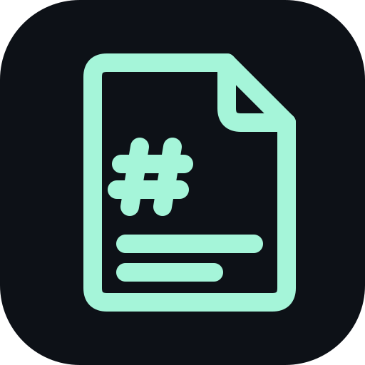

#  galeo

[](https://github.com/SWEStash/galeo/actions/workflows/ci.yml)
[](https://github.com/SWEStash/galeo/releases/latest)
[](LICENSE)

A fast, private desktop app for reading and editing Markdown, text and logs, JSON, CSV, YAML and
source code: the plans, notes, logs and data that coding-agent work produces. It never connects to
the network.

## Quick start

On Ubuntu 24.04 or later (x86_64), download `galeo_<version>_amd64.deb` from the
[latest release](https://github.com/SWEStash/galeo/releases/latest) and install it:

```sh
sudo apt install ./galeo_*_amd64.deb
galeo README.md
```

galeo is now also in *Open With* for Markdown, MDX, text, log, JSON, YAML, TOML, CSV and TSV files
and source code. An AppImage is available too; see [installation](docs/USAGE.md#installation) for
it and for checking a download.

## Features

- **Reading**: GitHub-style Markdown with code, math and Mermaid diagrams, and logs that can follow
  a growing file. Files reload when they change on disk.
- **Editing**: raw text with a live split preview. Saving keeps the file's encoding, line endings
  and permissions.
- **Data and code**: JSON as a tree, CSV and TSV as a table, YAML, TOML and source code
  highlighted, MDX rendered with nothing in it running.
- **Tabs, windows and profiles**: browser-like tabs, on top or on the left, that move between
  windows; sessions that come back after a restart; a profile per project.
- **Keyboard first**: quick open (Ctrl+P), a command palette (Ctrl+Shift+P), search tabs
  (Ctrl+Shift+A), a tab overview (Ctrl+Shift+E) and find in all tabs (Ctrl+Shift+F).
- **Private**: no network connections, documents can't run scripts, and Chromium's sandbox is on.

The [usage guide](docs/USAGE.md) covers all of it.

## Documentation

- [Usage guide](docs/USAGE.md): installation and everyday use
- [Product requirements](docs/PRD.md) and [UX specification](docs/design/ux.md)
- [Architecture](docs/ARCHITECTURE.md) and [decision records](docs/decisions/)
- [Threat model](docs/security/threat-model.md) and [dependencies](docs/dependencies.md)
- [Development](docs/development.md), [releasing](docs/RELEASING.md) and the
  [validation record](docs/VALIDATION.md)
- [Contributing](CONTRIBUTING.md)

## Licence

[MIT](LICENSE)
