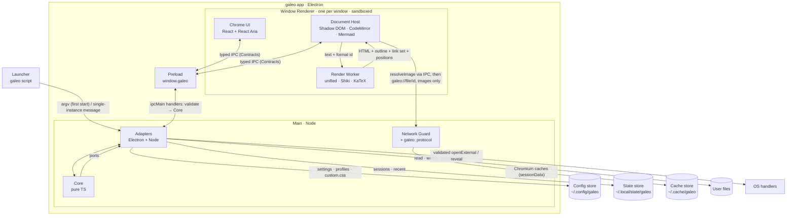
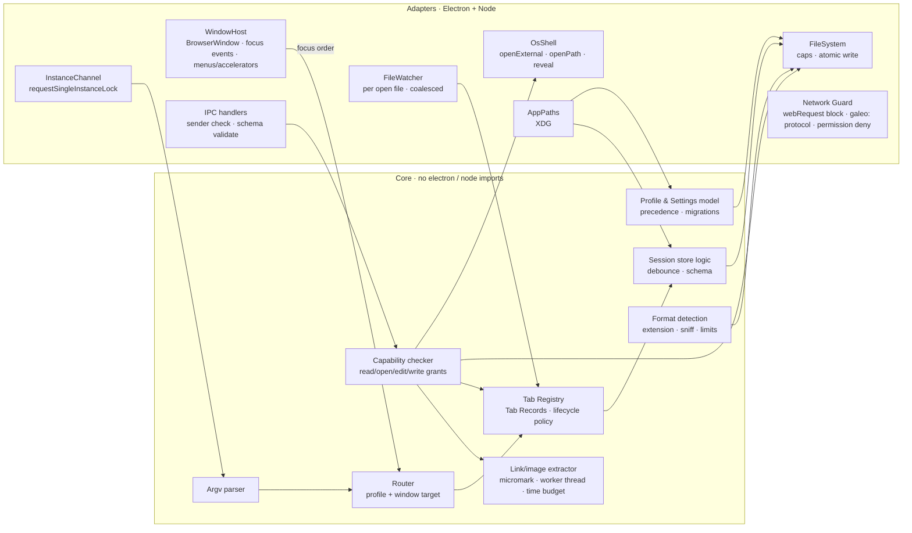
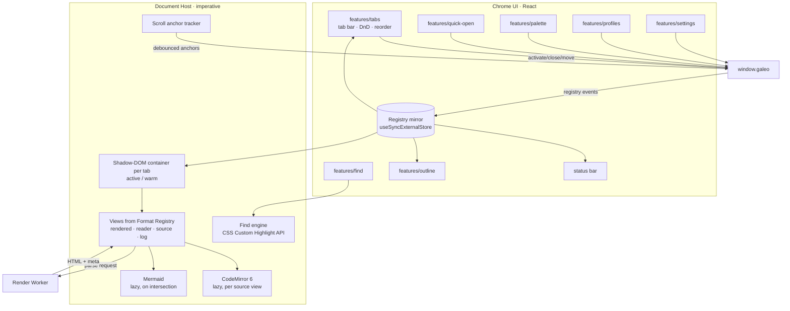
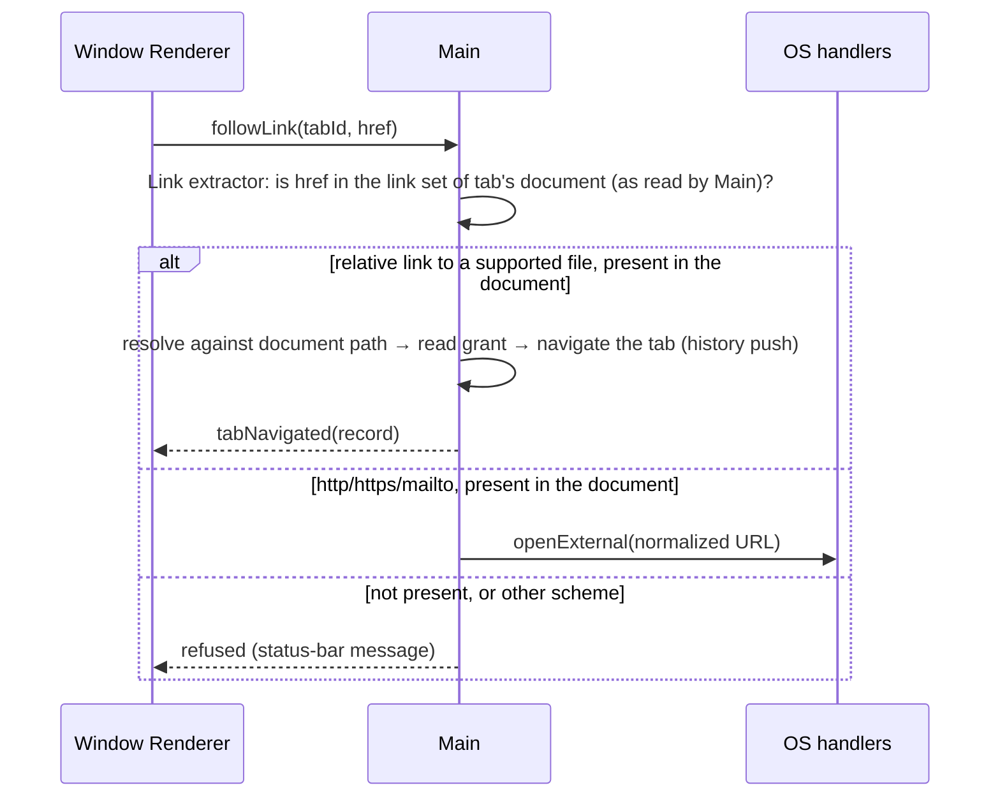

# galeo — Architecture

- **Status**: Current — design of record for v0.1–v0.2, matching the accepted ADRs (no code yet)
- **Date**: 2026-09-25 (updated 2026-09-26)
- **Sources**: [PRD](PRD.md) · [UX](design/ux.md) · [Threat model](security/threat-model.md) ·
  ADRs [001](decisions/ADR-001-app-shell-stack.md) ·
  [002](decisions/ADR-002-window-and-tab-model.md) ·
  [003](decisions/ADR-003-rendering-pipeline-and-format-registry.md) ·
  [004](decisions/ADR-004-security-and-zero-network.md) ·
  [005](decisions/ADR-005-profiles-and-session-persistence.md) ·
  [006](decisions/ADR-006-renderer-ui-framework.md) ·
  [007](decisions/ADR-007-platform-seam.md) ·
  [008](decisions/ADR-008-packaging-and-distribution.md) ·
  [009](decisions/ADR-009-sandbox-unavailable-launcher.md)

This document shows **what exists and how it connects**. The *why* lives in the ADRs; each
section links the decision it depicts. Diagrams are Mermaid, so they render on GitHub and in
galeo itself.

## 1. Glossary

Every diagram uses these names exactly.

| Name | Meaning |
|---|---|
| **Launcher** | The `gal` shell script. Passes `-- <absolute paths>` to the app binary. On Linux the binary sits behind a `galeo` wrapper that relaunches into the "sandbox unavailable" window after a real sandbox failure (ADR-009) |
| **Main** | The Electron main process (Node). Hosts the Core and the Adapters |
| **Core** | Pure TypeScript domain logic: routing, tab registry, lifecycle policy, sessions, settings, capability checks, argv parsing, link extraction (ADR-007) |
| **Adapters** | Electron and Node implementations of Core's ports: `FileSystem`, `FileWatcher`, `InstanceChannel`, `WindowHost`, `OsShell`, `AppPaths`, `SystemMetrics`, `TaskRunner`, `Clock` |
| **Network Guard** | The part of Main that cancels every non-`galeo:`/`data:` request, makes every host unresolvable in the network stack, and registers the `galeo:` protocol (ADR-004) |
| **Preload** | The only bridge. Exposes the typed `window.galeo` API from Contracts |
| **Contracts** | Shared IPC and domain types plus runtime schemas (`src/shared`) |
| **Window Renderer** | One sandboxed renderer process per window: Chrome UI + Document Host (ADR-002) |
| **Chrome UI** | React + React Aria app UI: tab bar, quick open, palette, find, outline, profile menu, settings, status bar (ADR-006) |
| **Document Host** | Owns one Shadow-DOM container per tab; inserts rendered HTML, mounts CodeMirror, renders Mermaid lazily, runs find (ADR-003) |
| **Render Worker** | One Web Worker per window running the unified pipeline + Shiki + KaTeX (ADR-003) |
| **Format Registry** | Descriptors mapping files to source and rendered views (ADR-003) |
| **Tab Record** | Plain data for a tab: path, view, scroll anchor, file identity, history (ADR-002) |
| **Profile** | A named context: windows + session + settings (ADR-005) |
| **Config / State / Cache stores** | XDG directories under `~/.config`, `~/.local/state` and `~/.cache` (`galeo/` in each) on Linux; `app.getPath()` equivalents on macOS/Windows previews |

## 2. System context

```mermaid
flowchart LR
  user([Developer<br/>owner / agent-heavy dev])
  subgraph machine[User's machine · single user]
    galeo[[galeo]]
    term[Terminal / coding agents<br/>Claude Code CLI]
    files[GNOME Files<br/>search · double-click · drag]
    fs[(User files<br/>repos, .local/, .claude/,<br/>scratchpads, downloads)]
    os[OS handlers<br/>system browser · mail]
  end
  net((Internet))

  user --> term & files & galeo
  term -- "galeo [--profile p] file…" --> galeo
  term -. agents write .md/.log .-> fs
  files -- "open %F / drag-and-drop" --> galeo
  galeo -- "read (write in v0.2 edit mode)" --> fs
  galeo -- "http/https/mailto links from the document only" --> os
  galeo -. never .-x net
```

galeo has **no network dependency**. It exchanges data only with local files, the Launcher,
the Files app (open and drag-and-drop) and OS URL handlers. That last channel is restricted to
link targets that appear in the open document (ADR-004).

## 3. Containers (processes and stores)



| Container | Runs | Trust | Owns |
|---|---|---|---|
| Launcher | `/bin/sh` | User | Nothing (stateless) |
| Main | Electron main, Node | Full user privileges | Tab registry, profiles, routing, capabilities, all disk and OS access |
| Preload | Isolated world of each renderer | Bridge | The API surface: nothing beyond Contracts |
| Window Renderer | Chromium renderer, sandboxed, no Node | **Untrusted** (renders hostile content) | DOM, render caches, UI state |
| Render Worker | Web Worker in the Window Renderer | Untrusted | Parse and highlight only; no DOM, no IPC |
| Config / State / Cache stores | Files, `0700`/`0600` | User | JSON + CSS (config); JSON sessions + snapshots and Chromium userData incl. the single-instance lock (state); Chromium caches only (cache) |

The trust boundaries B1–B8 in the threat model map onto these edges: B1/B2 is Launcher to
Adapters, B3 is Preload to Adapters, B4 is Adapters to the stores and user files, B5 is user file
content to Host/Worker, B6 is Network Guard, B7 is Adapters to OS handlers, B8 is the build
(section 8).

## 4. Components

### 4.1 Main (Core + Adapters)



- Each IPC handler follows the same path: **validate** (schema + sender), then **Capability
  checker**, then a Core operation, then Adapters. There is no handler that goes straight to
  Adapters.
- Capability-granting user actions (edit mode, "open with default app") come from **WindowHost
  `before-input-event` keys or native menus built by Main**, which Main observes directly
  (ADR-004). Drop grants come from the preload's isolated world (trusted drop events only).

### 4.2 Window Renderer



## 5. Runtime views

### 5.1 `galeo plan.md` while galeo is running

```mermaid
sequenceDiagram
  autonumber
  participant T as Terminal
  participant L as Launcher
  participant P2 as 2nd app process
  participant M as Main (Adapters + Core)
  participant R as Window Renderer
  participant W as Render Worker
  T->>L: galeo plan.md
  L->>P2: galeo -- /abs/plan.md
  P2->>M: single-instance message {argv, cwd}
  P2-->>T: exit 0 (immediately)
  M->>M: Argv parser → Router: target = last-focused window
  M->>M: Tab Registry: new Tab Record; read grant for /abs/plan.md
  M->>R: event tabOpened(record) + focus window
  R->>M: readDocument(tabId)
  M->>M: Capability check (grant) → FileSystem.read (size cap) → FileWatcher.watch
  M-->>R: text + file identity + format id
  R->>W: parse(markdown)
  W-->>R: HTML + outline + link set + positions
  R->>R: insert into Shadow DOM → paint (budget < 100 ms)
  R-->>M: anchor updates (debounced) → Session store (debounced atomic write)
```

### 5.2 Waking a hibernated tab

1. Chrome UI activates the tab locally (reported to Main afterwards, ADR-002 split ownership), and
   the Registry mirror shows it is *hibernated*.
2. The renderer calls `readDocument(tabId)`. Main checks the grant (from session restore), reads
   the file and compares its identity.
3. The Worker parses. The Host inserts the HTML *hidden*, scrolls to the saved anchor, then
   reveals it (no jump). Budget: 150 ms.
4. The lifecycle policy in Main (count + weight limits, sampled memory) may instruct the renderer
   to demote the least recently used warm tab to *hibernated*; the renderer drops that tab's DOM.

### 5.3 Live reload

`FileWatcher` (coalesced) → Tab Registry marks the record changed → event to the owning
renderer. If the tab is active, the renderer re-reads, re-parses, and re-inserts anchored to the
nearest block. Warm tabs are marked stale and re-render in idle time or on activation. Hibernated
tabs refresh on their next wake. Rename or delete puts
the tab in the *missing* state; if the path reappears, the watcher restores the tab.

### 5.4 Clicking a link (capability check)



### 5.5 Save (v0.2)

Ctrl+E (a Main accelerator) marks the tab edit-enabled in the Capability checker. Ctrl+S sends
`save(tabId, text, baseIdentity)`. Main then checks that the path is edit-enabled, compares the
file on disk with `baseIdentity`, and either writes atomically (temp file, fsync, rename,
preserving mode, writing through symlinks) or returns *conflict*, which leads to UX F12.

### 5.6 Cold start and session restore

The Launcher starts the app. Main takes the single-instance lock, sets up the Network Guard
**before any window exists**, loads app-state and the target profile's session, and creates
its windows. Each renderer loads Chrome UI (heavy features lazily), receives its Tab Records, and
renders only its active tab. Budget: first document painted within 500 ms.

## 6. Security architecture (map of ADR-004)

| Layer | Where it lives | Requirements |
|---|---|---|
| 1. Inert content | Render Worker (sanitize), Document Host (Shadow DOM, strict Mermaid), CSP on app pages | SR-02, SR-03 |
| 2. Hardened renderer | WindowHost window options, navigation and permission handlers, Fuses | SR-01, SR-08 |
| 3. Verified capabilities | IPC handlers → Capability checker, Link extractor, accelerators in WindowHost | SR-04, SR-05, SR-11, SR-12, SR-15 |
| 4. Zero network | Network Guard | SR-06 |
| 5. Proof | CI: socket-connect harness, fuse read-back, payload corpus | SR-07, SR-08, SR-10 |

## 7. Performance architecture

| PRD target | Mechanism |
|---|---|
| Cold start < 500 ms | Network Guard before windows; only the active tab renders; Chrome UI heavy features lazy-loaded; Mermaid, KaTeX, CodeMirror and Shiki grammars lazy |
| New tab < 100 ms | Worker parse; grammars only as needed; no process start (one renderer per window) |
| Warm switch within the next frame | Warm DOM kept (LRU budget); switching toggles visibility only |
| Hibernated wake < 150 ms | Re-read and re-parse in the worker, hidden insert, anchor, reveal |
| Live reload < 500 ms | Coalesced watcher per open file; re-parse in the worker; anchored re-insert |
| Smooth scrolling with diagrams | Mermaid renders on intersection, cached by content hash; `content-visibility` on off-screen blocks |
| Memory baseline | Renderers scale with windows, not tabs; warm budget with memory-pressure eviction |

The performance harness (`tests/perf/`) measures each row on the owner's machine and in CI.

## 8. Build, packaging and deployment (ADR-008)

```
source (src/shared · core · main · preload · renderer)
  └─ Vite 8 builds (main + preload as library builds, renderer, worker) · scripts/dev.mjs in development
      └─ electron-builder (fuses set) ─┬─ galeo_<v>_amd64.deb              (official)
                                       ├─ galeo-<v>-x86_64.AppImage        (secondary; unsandboxed on 24.04 only by opt-in)
                                       ├─ galeo-<v>-{x64,arm64}.dmg/.zip   (macOS preview, unsigned)
                                       └─ galeo-Setup-<v>.exe              (Windows preview, unsigned)
          CI (matrix ubuntu/macos/windows): tests · fuse read-back · no-network harness (Linux) ·
              SHA256SUMS · attestations
              └─ semantic-release → GitHub Release
```

Installed layout (`.deb`): `/opt/galeo/` (app: the `galeo` wrapper and the `galeo-bin`
Electron binary, ADR-009), `/etc/apparmor.d/galeo` (`userns` profile for `galeo-bin`, for
Chromium's sandbox on Ubuntu 24.04+), `/usr/bin/gal` (Launcher),
`/usr/share/applications/galeo.desktop` (`Exec=galeo -- %F`, MIME types),
`/usr/share/icons/hicolor/*/apps/galeo.png`. Per-user data lives only in the Config, State and
Cache stores.

## 9. Source layout (ADR-007)

```
src/
  shared/     contracts (IPC schemas + types), domain types
  core/       routing, registry, lifecycle, sessions, settings, capabilities, links, formats
  main/       adapters, IPC handlers, network guard, window host, app entry
  preload/    window.galeo bridge
  renderer/   app/ · features/{tabs,quick-open,palette,find,outline,profiles,settings,document}
              components/ · lib/ (tokens, store) · worker/ (render pipeline) · formats/ (registry)
tests/
  unit/       core + shared (vitest, node)
  renderer/   pipeline, sanitizer corpus, format registry (vitest)
  e2e/        Playwright for Electron: CLI open, tabs, DnD, reload, profiles, a11y (axe)
  security/   payload corpus, no-network harness, fuse check
  perf/       harness for PRD targets
```

Import rules, enforced in CI: `core` and `shared` import no `electron`, `node:*` or DOM code;
`renderer` imports no `electron` or `node:*`; only `main` imports `electron`.

## 10. Maintenance

Update this document, in the same PR, when:
- a process, store, port or IPC contract is added or removed;
- a trust boundary changes (new entry point, network feature, OS integration), which also means
  updating the threat model;
- an ADR is accepted that changes structure: that ADR links the affected section here.

Review it before each minor release, against `src/` and the ADR log.
