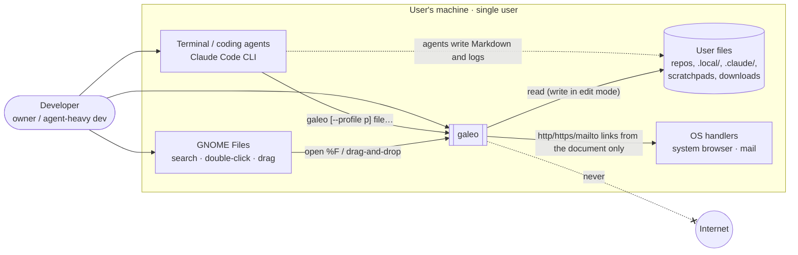
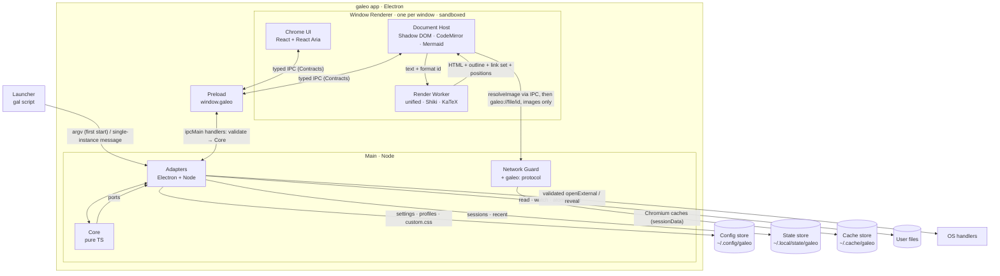
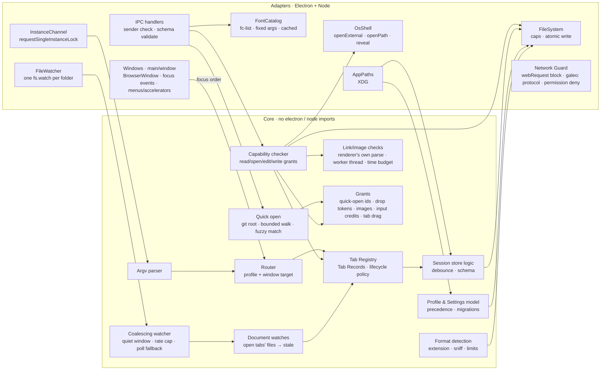
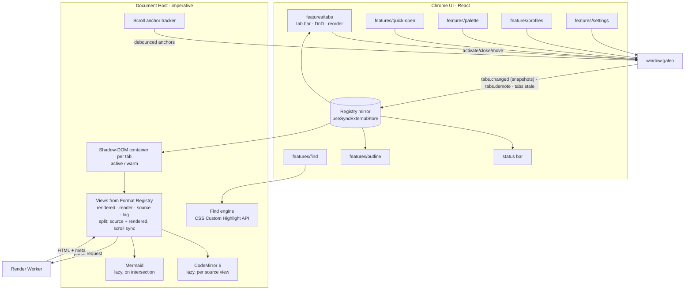
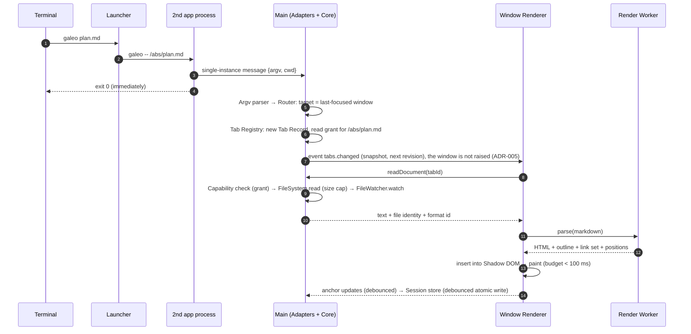
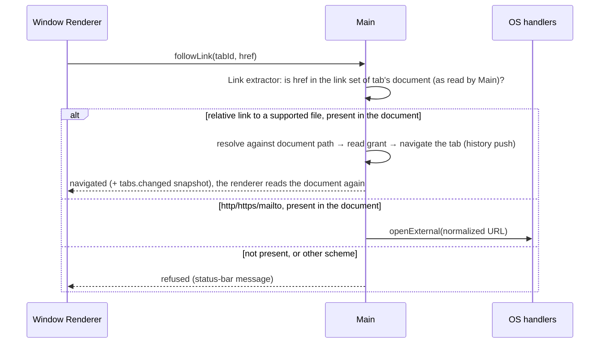
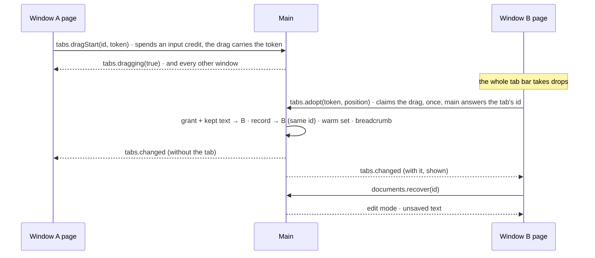
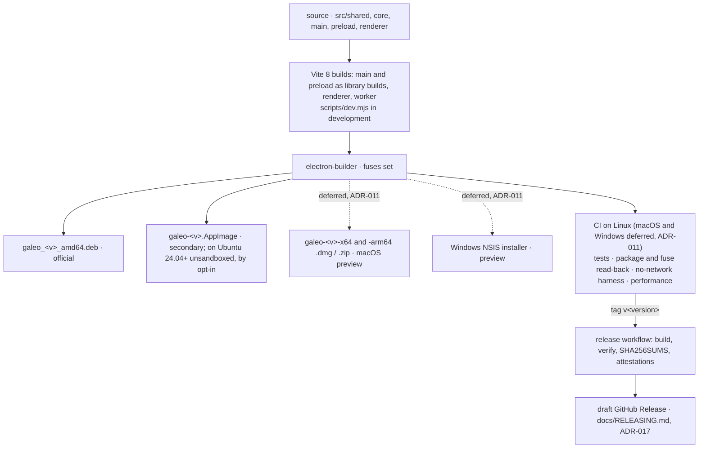

# galeo — Architecture

- **Status**: Current — design of record for v0.1–v0.2, matching the accepted ADRs and kept in step with the code
- **Date**: 2026-09-25 (updated 2026-09-26)
- **Sources**: [PRD](PRD.md) · [UX](design/ux.md) · [Threat model](security/threat-model.md) ·
  ADRs [001](decisions/ADR-001-app-shell-stack.md) ·
  [002](decisions/ADR-002-window-and-tab-model.md) ·
  [003](decisions/ADR-003-rendering-pipeline-and-format-registry.md) ·
  [004](decisions/ADR-004-security-and-zero-network.md) ·
  [005](decisions/ADR-005-profiles-and-session-persistence.md) ·
  [006](decisions/ADR-006-renderer-ui-framework.md) ·
  [007](decisions/ADR-007-platform-seam.md) ·
  [008](decisions/ADR-008-packaging-and-distribution.md) ·
  [009](decisions/ADR-009-sandbox-unavailable-launcher.md) ·
  [010](decisions/ADR-010-trusted-types-enforcement.md) ·
  [011](decisions/ADR-011-defer-macos-windows-ci.md) ·
  [012](decisions/ADR-012-hand-run-releases-until-public.md) ·
  [013](decisions/ADR-013-edit-and-save-model.md) ·
  [014](decisions/ADR-014-split-view-and-scroll-sync.md) ·
  [015](decisions/ADR-015-edit-grant-for-files-the-reader-chose.md) ·
  [016](decisions/ADR-016-name-galeo.md) ·
  [017](decisions/ADR-017-release-workflow-with-attestations.md) ·
  [018](decisions/ADR-018-rich-views-and-the-format-descriptor.md) ·
  [019](decisions/ADR-019-moving-tabs-between-windows.md) ·
  [020](decisions/ADR-020-table-budget-and-show-as-table.md) ·
  [021](decisions/ADR-021-table-options.md) ·
  [022](decisions/ADR-022-drag-tokens.md) ·
  [023](decisions/ADR-023-window-layout-with-tabs-on-the-left.md) ·
  [024](decisions/ADR-024-find-in-all-tabs.md) ·
  [025](decisions/ADR-025-no-window-host-port.md) ·
  [026](decisions/ADR-026-window-lifecycle-hooks.md)

This document shows **what exists and how it connects**. The *why* lives in the ADRs; each
section links the decision it depicts. Diagrams are Mermaid, so they render on GitHub and in
galeo itself.

## 1. Glossary

Every diagram uses these names exactly.

| Name | Meaning |
|---|---|
| **Launcher** | The `gal` shell script. Passes `-- <absolute paths>` to the app binary. On Linux the binary sits behind a `galeo` wrapper that routes every launch through `gal`'s argument handling and relaunches into the "sandbox unavailable" window after a real sandbox failure (ADR-009) |
| **Main** | The Electron main process (Node). Hosts the Core and the Adapters |
| **Core** | Pure TypeScript domain logic: routing, tab registry, lifecycle policy, sessions, settings, capability checks, argv parsing, link extraction (ADR-007) |
| **Adapters** | Electron and Node implementations of Core's ports: `FileSystem`, `FileWatcher`, `InstanceChannel`, `OsShell`, `Clipboard`, `AppPaths`, `SystemMetrics`, `TaskRunner`, `FontCatalog`, `Clock`. Window code is Main's own (`src/main/window/`), not a port (ADR-025) |
| **Network Guard** | The part of Main that cancels every non-`galeo:`/`data:` request, makes every host unresolvable in the network stack, and registers the `galeo:` protocol (ADR-004) |
| **Preload** | The only bridge. Exposes the typed `window.galeo` API from Contracts |
| **Contracts** | Shared IPC and domain types plus runtime schemas (`src/shared`) |
| **Window Renderer** | One sandboxed renderer process per window: Chrome UI + Document Host (ADR-002) |
| **Chrome UI** | React + React Aria app UI: tab bar, quick open, palette, find, outline, profile menu, settings, status bar (ADR-006) |
| **Document Host** | Owns one Shadow-DOM container per tab; inserts rendered HTML, mounts CodeMirror, renders Mermaid lazily, runs find, and replace in the source in edit mode (ADR-003); draws a JSON tree or a CSV/TSV table itself from the worker's offsets, only the rows (and table columns) in view, which then answer for the reader's place (ADR-018, ADR-021); in split view shows the source and rendered panes side by side and keeps them on the same block (ADR-014) |
| **Render Worker** | One Web Worker per window running the unified pipeline + Shiki + KaTeX (ADR-003), for Markdown and MDX (MDX is parsed, never run), and the CSV/TSV and JSON readers, which hand a table or a tree back as offsets into the text (ADR-018). The pipeline loads with the window's first Markdown or MDX document, and the MDX parser with the first `.mdx`; a render over its budget (2 s; a CSV/TSV table 30 s, ADR-020) is refused and the worker replaced, so the tab shows source, and the reader can cancel one that runs over 5 s the same way; a live preview's render (split while editing) skips the cache, only its latest text is rendered, and over budget the last good preview stays (ADR-014) |
| **Format Registry** | One descriptor per format, split by layer (ADR-003, ADR-018): core detects the format by extension or name (source code by a shared table that also names each file's language) and picks the default view and size limit; a shared table says which views and modes its tab offers (rendered by the worker, by the page, or not at all; reader, split, outline, follow, edit); the page adds the source language, whose grammar `@codemirror/language-data` loads with the first file that needs it, and the format's display name |
| **Tab Record** | Plain data for a tab: path, view, scroll anchor, file identity, history (ADR-002) |
| **Profile** | A named context: windows + session + settings (ADR-005) |
| **Config / State / Cache stores** | XDG directories under `~/.config`, `~/.local/state` and `~/.cache` (`galeo/` in each) on Linux; `app.getPath()` equivalents on macOS/Windows previews |

## 2. System context



galeo has **no network dependency**. It exchanges data only with local files, the Launcher,
the Files app (open and drag-and-drop) and OS URL handlers. That last channel is restricted to
link targets that appear in the open document (ADR-004). On Linux it also asks fontconfig's
`fc-list` for the installed font families, for Settings' font pickers: fixed arguments, nothing
from the page.

## 3. Containers (processes and stores)



| Container | Runs | Trust | Owns |
|---|---|---|---|
| Launcher | `/bin/sh` | User | Nothing (stateless) |
| Main | Electron main, Node | Full user privileges | Tab registry, profiles, routing, capabilities, all disk and OS access |
| Preload | Isolated world of each renderer | Bridge | The API surface: nothing beyond Contracts |
| Window Renderer | Chromium renderer, sandboxed, no Node | **Untrusted** (renders hostile content) | DOM, render caches, UI state |
| Render Worker | Web Worker in the Window Renderer | Untrusted | Parse and highlight only; no DOM, no IPC |
| Config / State / Cache stores | Files, `0700`/`0600` | User | JSON + CSS (config); JSON sessions + snapshots and Chromium userData incl. the single-instance lock (state); Chromium caches only (cache) |

The trust boundaries B1–B8 in the threat model map onto these edges: B1/B2 is Launcher to
Adapters, B3 is Preload to Adapters, B4 is Adapters to the stores and user files, B5 is user file
content to Host/Worker, B6 is Network Guard, B7 is Adapters to OS handlers, B8 is the build
(section 8).

## 4. Components

### 4.1 Main (Core + Adapters)



- Each IPC handler follows the same path: **validate** (schema + sender), then **Capability
  checker**, then a Core operation, then Adapters. There is no handler that goes straight to
  Adapters.
- Capability-granting user actions (edit mode, "open with default app") come from **`before-input-event`
  keys in Main's window code or native menus built by Main**, which Main observes directly
  (ADR-004). Drop grants come from the preload's isolated world (trusted drop events only); the
  page gets a one-time token and says where the files landed. Quick open walks and matches in
  Main and offers the page ids for the files it lists, never paths to request.
  The window keys (new window, close window, quit, full screen) are taken there too, so they
  work while a page is busy; the palette asks for the same four over `window.command`.
- Main runs one **profile runtime** per running profile: its settings (watching `settings.json`,
  `profile.json` and both `custom.css`), session, recent files and windows. Every open request
  (first launch, a forwarded launch, the macOS dock) goes through one queue: argv parser →
  Router (running profiles, the global focus order, `app-state.json`'s last profile) → the
  target window, starting a profile first when needed. A profile's last window closing saves
  and stops it. Window ids are the page's `webContents` id, which tabs, grants and metrics share.
- `src/main/index.ts` is the composition root: it creates the services, wires them and keeps the
  start-up order (§5.6). The IPC channels are served by one handler group per area
  (`main/*/handlers.ts`, `session-handlers.ts`, `recent-handlers.ts`), joined in one registration.
  The running profiles and their pending saves are `main/profiles/lifecycle.ts`. A window's own
  behaviour (bounds, focus order, the close guard, input credits, crash recovery) is a hook in
  `main/window/hooks.ts` with only what it needs, and every per-window registry registers its
  cleanup where it is created, run when the window closes (ADR-026).

### 4.2 Window Renderer



- Each window takes its colour scheme from its own profile's theme mode (the desktop's in
  system mode). Main leaves Electron's process-wide theme on system and recolours each window's
  title-bar controls, so native menus and dialogs follow the desktop.
- The profile's reading settings reach documents as `--galeo-*` tokens they inherit. The global and
  profile `custom.css`, sent by Main, are constructable sheets adopted by every document's shadow
  root after the bundled theme, and nowhere else: app chrome keeps its own styles (SR-17).

## 5. Runtime views

### 5.1 `galeo plan.md` while galeo is running



### 5.2 Waking a hibernated tab

1. Chrome UI activates the tab locally (reported to Main afterwards, ADR-002 split ownership), and
   the Registry mirror shows it is *hibernated*.
2. The renderer calls `readDocument(tabId)`. Main checks the grant (from session restore), reads
   the file and compares its identity.
3. The Worker parses. The Host inserts the HTML *hidden*, scrolls to the saved anchor, then
   reveals it (no jump). Budget: 150 ms.
4. The renderer reports the tab's rendered weight (`tabs.rendered`). The lifecycle policy in Main
   (count + weight limits, sampled memory) may then send `tabs.demote` for the least recently
   shown warm tabs; the renderer drops their DOM and keeps their scroll anchors.
5. Showing a *warm* tab again, Main compares the file's identity with the read it shows and sends
   `tabs.stale` if it changed; the renderer reads it again at the same place.

### 5.3 Live reload

Main watches the file of every open document tab. `FileWatcher` events go through Core's
coalescing watcher (a burst arrives once, at most four times a second; an unwatchable folder is
polled), then the read-identity check, then `tabs.stale` to the owning renderer. The shown tab
re-reads and updates in place, keeping its view, find and follow state; the heading above the view
keeps its distance, else the block at the top does. A warm tab takes the change when it is shown
again; hibernated tabs refresh on their next wake. Rename or delete puts the tab in the *missing*
state; if the path reappears, the tab reads it again.

### 5.4 Clicking a link (capability check)



### 5.5 Save (ADR-013)

Ctrl+E (a Main accelerator) grants the shown tab edit mode (`EditGrants`, core) and tells the page
(`documents.editMode`); a second Ctrl+E asks the page to leave, which it does once its text is
saved or discarded. Main grants only a file it last read as text with content, and otherwise
answers *refused*. A file the reader didn't hand over (its history entry isn't `chosen`: it
came from a link, a drop, quick open or recent files, not the command line, Files or a second
launch) is granted only after main's native dialog, naming the path, is answered *Edit*
(ADR-015). Each read names its version: the SHA-256 of the bytes main read. Ctrl+S sends
`documents.save(tabId, text, version)`, which spends an input credit. Main checks the grant, then
reads the file again: if its hash isn't `version`, it answers *conflict* and writes nothing.
Otherwise it encodes the text the way those bytes were (encoding, byte order mark, line endings)
and saves through the file system port: on the symlink's target, through a temp file that keeps
mode, owner and group, then a rename; in place for a hard-linked file or one whose owner or group
the temp file can't take; refused for a file the user can't write, or when the encoded text is
over 256 MB. The same write removes that file's temp files left by a crash more than an hour
ago. The new identity is remembered before the watcher reports the write, so the page reads the file again itself after each save. A null `version` writes back a file that was deleted, only
while it is still gone, in the shape of the tab's last read (`ReadIdentities` keeps the encoding,
byte order mark and line endings, never the text).

A change on disk reaches a tab with unsaved changes as a new read like any other (`tabs.stale`);
the page keeps its text and shows the "File changed on disk" bar (UX F12) instead of taking it.
*Show diff* loads `@codemirror/merge` with the first diff.

While a tab has unsaved changes, the page reports it (`documents.dirty`) and hands main its text
a second after typing stops (`documents.keep`, memory only). Main holds window closes, quits and
profile deletes until each affected page has asked its reader (`documents.confirmClose`, answered
by `documents.closeAnswer`: *asking* within 5 s, then the choice). After a renderer crash, a tab
gets its kept text back (`documents.recover`), and so does a tab moved to another window (§5.7).

In split view (ADR-014) the rendered pane previews the editor's text, not the file's: the page
sends it to the worker 150 ms after typing pauses, and at least once a second while it goes on.
Both panes meet on a source line through the blocks' `data-src-line` and `data-src-end`; the pane
the reader scrolls leads, and a pane whose content just changed follows without taking the lead.

### 5.6 Cold start and session restore

The Launcher starts the app. Main takes the single-instance lock, sets up the Network Guard
**before any window exists**, loads app-state and the target profile's session, and creates
its windows. On Linux the first window waits for the desktop's theme settings, at most 400 ms after
the app is ready: Chromium reads them over D-Bus and re-themes every open window when they arrive,
which holds main's thread for some 300 ms while a window exists, and the page's own files are served
on that thread. Each renderer loads Chrome UI (heavy features lazily), receives its Tab Records, and
renders only its active tab. Budget: first document painted within 500 ms.

### 5.7 Moving a tab to another window (ADR-019, ADR-022)



The drag carries only a single-use token the page makes for it, in galeo's own type, never the tab
id (ADR-022): only a window the reader drags over learns it. Main keeps one pending drag (`TabDrags`):
a window takes a tab only by claiming it, so a page can't pull tabs out of other windows, and a
drop and a tear-off can't both happen. A window opened during the drag hears of it when it first
asks for its tabs. When the drag ends, A tells main
`tabs.dragEnd(id, outside)`, and the drag stays claimable for half a second: B's adopt may reach
main after it. A drag still unclaimed then, that ended with the pointer out of window A, over the
desktop or any other application, is a tear-off: main opens a window of A's profile, at A's size,
and moves the tab there. The palette's moves (`tabs.moveTo`) take the same path in main,
`tabMover`, which closes a window its last tab left; a profile whose last window closed that way
saves a session without it. Into another profile's window, the tab joins that profile's session.

## 6. Security architecture (map of ADR-004)

| Layer | Where it lives | Requirements |
|---|---|---|
| 1. Inert content | Render Worker (sanitize), Document Host (Shadow DOM, strict Mermaid), CSP on app pages | SR-02, SR-03 |
| 2. Hardened renderer | Window options (`src/main/window/`), navigation and permission handlers, Fuses | SR-01, SR-08 |
| 3. Verified capabilities | IPC handlers → Capability checker, Link extractor, accelerators in Main's window code | SR-04, SR-05, SR-11, SR-12, SR-15 |
| 4. Zero network | Network Guard | SR-06 |
| 5. Proof | CI: socket-connect harness, fuse read-back, payload corpus | SR-07, SR-08, SR-10 |

The pre-release security audits check these layers against the code:
[v0.1](security/audits/2026-10-07-v0.1.md), [v0.2](security/audits/2026-10-10-v0.2.md) and
[v0.3](security/audits/2026-10-20-v0.3.md).

## 7. Performance architecture

| PRD target | Mechanism |
|---|---|
| Cold start < 500 ms | Network Guard before windows; on Linux the first window opens after the desktop's theme settings (§5.6); a new window's page paints from the start info it was created with, not waiting on main; only the active tab renders; Mermaid, KaTeX (worker and styles), Shiki, CodeMirror and each CodeMirror grammar load with the first document that needs them, which `npm run check:bundle` enforces; the Settings tab loads when first shown |
| New tab < 100 ms | Worker parse; grammars only as needed; no process start (one renderer per window) |
| Warm switch within the next frame | Warm DOM kept (LRU budget); switching toggles visibility only |
| Hibernated wake < 150 ms | Re-read and re-parse in the worker, hidden insert, anchor, reveal |
| Live reload < 500 ms | Coalesced watcher per open file; re-parse in the worker; anchored re-insert |
| Smooth scrolling with diagrams | Mermaid draws a diagram within 200 px of the view at once, and one within two screens when the page is idle; cached by scheme and source; a cached diagram comes back at once. Drawing one takes the UI thread for up to about 100 ms, which the perf suite records |
| Memory baseline | Renderers scale with windows, not tabs; warm budget with memory-pressure eviction |
| Typing in split < 300 ms (v0.2) | A render once typing pauses for 150 ms, at least once a second; only the latest text is rendered, outside the cache; drawn diagrams come back from their cache |

The performance harness (`tests/perf/`) measures each row on the owner's machine and in CI.

## 8. Build, packaging and deployment (ADR-008, ADR-017)



Installed layout (`.deb`): `/opt/galeo/` (app: the `galeo` wrapper and the `galeo-bin`
Electron binary, ADR-009), `/etc/apparmor.d/galeo` (`userns` profile for `galeo-bin`, for
Chromium's sandbox on Ubuntu 24.04+), `/usr/bin/gal` (Launcher),
`/usr/share/applications/galeo.desktop` (`Exec=/opt/galeo/galeo -- %F`, MIME types),
`/usr/share/mime/packages/galeo.xml` (the `text/mdx` type, copied there by the post-install
script), `/usr/share/icons/hicolor/*/apps/galeo.png`. Per-user data lives only in the Config, State and
Cache stores.

## 9. Source layout (ADR-007)

```
src/
  shared/     contracts (IPC schemas + types), domain types, default settings, keymap, formats (what
              each format's tab offers), small helpers (clamp, plural, errorMessage, keysOf),
              markdown/ (the parse up to sanitizing, MDX handling, sanitize schema, link and image
              rules and extraction: the page and main parse a document, Markdown or MDX, with the
              same function, so they find its links the same way)
  core/       routing, profiles, registry, lifecycle, sessions, settings, capabilities, links,
              formats, desktop (the AppImage's launcher files), watch/ (coalescing),
              quick-open/ (git root, walker, matcher, session), documents/ (reads, identities,
              grants, watches), text/ (decode and encode), fonts/ (fc-list parsing), ports/
  main/       index.ts (the composition root), adapters, IPC handler groups (one per area),
              network guard, window/ (factory, hooks, cleanups, focus order, crash recovery,
              menus), profiles/ (runtimes, the running profiles), tasks/ (the worker thread for the
              parsing main's checks need, and find in all tabs)
  preload/    window.galeo bridge
  renderer/   document/ (host, rendered/source/text/log views, diagrams, find, states) · tabs/
              (tab bar, side panel, store, status bar, empty window, drops, tab search, tab
              overview, find in all tabs) · edit/ (editors, unsaved prompt, diff) · about/ ·
              security/ (Trusted Types, WebRTC off) · commands/ (dispatcher) ·
              quick-open/ · palette/ · outline/ · profiles/ (chip, menu, dialogs) · settings/
              (Settings tab, fields, notices, tokens) · styles/ (tokens, fonts) · worker/ (render
              pipeline) · app/ (the window's hooks: tab shortcuts, overlays, palette actions) ·
              testing/ (helpers for the component tests only)
tests/
  unit/       core + shared (vitest, node)
  renderer/   pipeline, sanitizer corpus, format registry (vitest)
  e2e/        Playwright for Electron: CLI open, tabs, DnD, reload, profiles, a11y (axe)
  security/   payload corpus, no-network harness, fuse check
  perf/       harness for PRD targets
  warm-up/    one app start before CI's e2e suite (a fresh machine's first start is slow)
```

Import rules, enforced in CI: `core` and `shared` import no `electron`, `node:*` or DOM code;
`renderer` imports no `electron` or `node:*`; only `main` imports `electron`.

## 10. Maintenance

Update this document, in the same PR, when:
- a process, store, port or IPC contract is added or removed;
- a trust boundary changes (new entry point, network feature, OS integration), which also means
  updating the threat model;
- an ADR is accepted that changes structure: that ADR links the affected section here.

Review it before each minor release, against `src/` and the ADR log.
