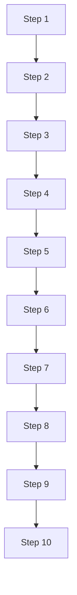

# Heavy diagrams

Forty flowcharts, each with ten nodes, for the scrolling smoke.

## Diagram 1

Paragraph before diagram 1.



## Diagram 2

Paragraph before diagram 2.


## Diagram 3

Paragraph before diagram 3.


## Diagram 4

Paragraph before diagram 4.


## Diagram 5

Paragraph before diagram 5.


## Diagram 6

Paragraph before diagram 6.


## Diagram 7

Paragraph before diagram 7.


## Diagram 8

Paragraph before diagram 8.


## Diagram 9

Paragraph before diagram 9.


## Diagram 10

Paragraph before diagram 10.


## Diagram 11

Paragraph before diagram 11.


## Diagram 12

Paragraph before diagram 12.


## Diagram 13

Paragraph before diagram 13.


## Diagram 14

Paragraph before diagram 14.


## Diagram 15

Paragraph before diagram 15.


## Diagram 16

Paragraph before diagram 16.


## Diagram 17

Paragraph before diagram 17.


## Diagram 18

Paragraph before diagram 18.


## Diagram 19

Paragraph before diagram 19.


## Diagram 20

Paragraph before diagram 20.


## Diagram 21

Paragraph before diagram 21.

```mermaid
flowchart TD
  N21_1[Step 1] --> N21_2[Step 2]
  N21_2[Step 2] --> N21_3[Step 3]
  N21_3[Step 3] --> N21_4[Step 4]
  N21_4[Step 4] --> N21_5[Step 5]
  N21_5[Step 5] --> N21_6[Step 6]
  N21_6[Step 6] --> N21_7[Step 7]
  N21_7[Step 7] --> N21_8[Step 8]
  N21_8[Step 8] --> N21_9[Step 9]
  N21_9[Step 9] --> N21_10[Step 10]
```

## Diagram 22

Paragraph before diagram 22.

```mermaid
flowchart TD
  N22_1[Step 1] --> N22_2[Step 2]
  N22_2[Step 2] --> N22_3[Step 3]
  N22_3[Step 3] --> N22_4[Step 4]
  N22_4[Step 4] --> N22_5[Step 5]
  N22_5[Step 5] --> N22_6[Step 6]
  N22_6[Step 6] --> N22_7[Step 7]
  N22_7[Step 7] --> N22_8[Step 8]
  N22_8[Step 8] --> N22_9[Step 9]
  N22_9[Step 9] --> N22_10[Step 10]
```

## Diagram 23

Paragraph before diagram 23.

```mermaid
flowchart TD
  N23_1[Step 1] --> N23_2[Step 2]
  N23_2[Step 2] --> N23_3[Step 3]
  N23_3[Step 3] --> N23_4[Step 4]
  N23_4[Step 4] --> N23_5[Step 5]
  N23_5[Step 5] --> N23_6[Step 6]
  N23_6[Step 6] --> N23_7[Step 7]
  N23_7[Step 7] --> N23_8[Step 8]
  N23_8[Step 8] --> N23_9[Step 9]
  N23_9[Step 9] --> N23_10[Step 10]
```

## Diagram 24

Paragraph before diagram 24.

```mermaid
flowchart TD
  N24_1[Step 1] --> N24_2[Step 2]
  N24_2[Step 2] --> N24_3[Step 3]
  N24_3[Step 3] --> N24_4[Step 4]
  N24_4[Step 4] --> N24_5[Step 5]
  N24_5[Step 5] --> N24_6[Step 6]
  N24_6[Step 6] --> N24_7[Step 7]
  N24_7[Step 7] --> N24_8[Step 8]
  N24_8[Step 8] --> N24_9[Step 9]
  N24_9[Step 9] --> N24_10[Step 10]
```

## Diagram 25

Paragraph before diagram 25.

```mermaid
flowchart TD
  N25_1[Step 1] --> N25_2[Step 2]
  N25_2[Step 2] --> N25_3[Step 3]
  N25_3[Step 3] --> N25_4[Step 4]
  N25_4[Step 4] --> N25_5[Step 5]
  N25_5[Step 5] --> N25_6[Step 6]
  N25_6[Step 6] --> N25_7[Step 7]
  N25_7[Step 7] --> N25_8[Step 8]
  N25_8[Step 8] --> N25_9[Step 9]
  N25_9[Step 9] --> N25_10[Step 10]
```

## Diagram 26

Paragraph before diagram 26.

```mermaid
flowchart TD
  N26_1[Step 1] --> N26_2[Step 2]
  N26_2[Step 2] --> N26_3[Step 3]
  N26_3[Step 3] --> N26_4[Step 4]
  N26_4[Step 4] --> N26_5[Step 5]
  N26_5[Step 5] --> N26_6[Step 6]
  N26_6[Step 6] --> N26_7[Step 7]
  N26_7[Step 7] --> N26_8[Step 8]
  N26_8[Step 8] --> N26_9[Step 9]
  N26_9[Step 9] --> N26_10[Step 10]
```

## Diagram 27

Paragraph before diagram 27.

```mermaid
flowchart TD
  N27_1[Step 1] --> N27_2[Step 2]
  N27_2[Step 2] --> N27_3[Step 3]
  N27_3[Step 3] --> N27_4[Step 4]
  N27_4[Step 4] --> N27_5[Step 5]
  N27_5[Step 5] --> N27_6[Step 6]
  N27_6[Step 6] --> N27_7[Step 7]
  N27_7[Step 7] --> N27_8[Step 8]
  N27_8[Step 8] --> N27_9[Step 9]
  N27_9[Step 9] --> N27_10[Step 10]
```

## Diagram 28

Paragraph before diagram 28.

```mermaid
flowchart TD
  N28_1[Step 1] --> N28_2[Step 2]
  N28_2[Step 2] --> N28_3[Step 3]
  N28_3[Step 3] --> N28_4[Step 4]
  N28_4[Step 4] --> N28_5[Step 5]
  N28_5[Step 5] --> N28_6[Step 6]
  N28_6[Step 6] --> N28_7[Step 7]
  N28_7[Step 7] --> N28_8[Step 8]
  N28_8[Step 8] --> N28_9[Step 9]
  N28_9[Step 9] --> N28_10[Step 10]
```

## Diagram 29

Paragraph before diagram 29.

```mermaid
flowchart TD
  N29_1[Step 1] --> N29_2[Step 2]
  N29_2[Step 2] --> N29_3[Step 3]
  N29_3[Step 3] --> N29_4[Step 4]
  N29_4[Step 4] --> N29_5[Step 5]
  N29_5[Step 5] --> N29_6[Step 6]
  N29_6[Step 6] --> N29_7[Step 7]
  N29_7[Step 7] --> N29_8[Step 8]
  N29_8[Step 8] --> N29_9[Step 9]
  N29_9[Step 9] --> N29_10[Step 10]
```

## Diagram 30

Paragraph before diagram 30.

```mermaid
flowchart TD
  N30_1[Step 1] --> N30_2[Step 2]
  N30_2[Step 2] --> N30_3[Step 3]
  N30_3[Step 3] --> N30_4[Step 4]
  N30_4[Step 4] --> N30_5[Step 5]
  N30_5[Step 5] --> N30_6[Step 6]
  N30_6[Step 6] --> N30_7[Step 7]
  N30_7[Step 7] --> N30_8[Step 8]
  N30_8[Step 8] --> N30_9[Step 9]
  N30_9[Step 9] --> N30_10[Step 10]
```

## Diagram 31

Paragraph before diagram 31.

```mermaid
flowchart TD
  N31_1[Step 1] --> N31_2[Step 2]
  N31_2[Step 2] --> N31_3[Step 3]
  N31_3[Step 3] --> N31_4[Step 4]
  N31_4[Step 4] --> N31_5[Step 5]
  N31_5[Step 5] --> N31_6[Step 6]
  N31_6[Step 6] --> N31_7[Step 7]
  N31_7[Step 7] --> N31_8[Step 8]
  N31_8[Step 8] --> N31_9[Step 9]
  N31_9[Step 9] --> N31_10[Step 10]
```

## Diagram 32

Paragraph before diagram 32.

```mermaid
flowchart TD
  N32_1[Step 1] --> N32_2[Step 2]
  N32_2[Step 2] --> N32_3[Step 3]
  N32_3[Step 3] --> N32_4[Step 4]
  N32_4[Step 4] --> N32_5[Step 5]
  N32_5[Step 5] --> N32_6[Step 6]
  N32_6[Step 6] --> N32_7[Step 7]
  N32_7[Step 7] --> N32_8[Step 8]
  N32_8[Step 8] --> N32_9[Step 9]
  N32_9[Step 9] --> N32_10[Step 10]
```

## Diagram 33

Paragraph before diagram 33.

```mermaid
flowchart TD
  N33_1[Step 1] --> N33_2[Step 2]
  N33_2[Step 2] --> N33_3[Step 3]
  N33_3[Step 3] --> N33_4[Step 4]
  N33_4[Step 4] --> N33_5[Step 5]
  N33_5[Step 5] --> N33_6[Step 6]
  N33_6[Step 6] --> N33_7[Step 7]
  N33_7[Step 7] --> N33_8[Step 8]
  N33_8[Step 8] --> N33_9[Step 9]
  N33_9[Step 9] --> N33_10[Step 10]
```

## Diagram 34

Paragraph before diagram 34.

```mermaid
flowchart TD
  N34_1[Step 1] --> N34_2[Step 2]
  N34_2[Step 2] --> N34_3[Step 3]
  N34_3[Step 3] --> N34_4[Step 4]
  N34_4[Step 4] --> N34_5[Step 5]
  N34_5[Step 5] --> N34_6[Step 6]
  N34_6[Step 6] --> N34_7[Step 7]
  N34_7[Step 7] --> N34_8[Step 8]
  N34_8[Step 8] --> N34_9[Step 9]
  N34_9[Step 9] --> N34_10[Step 10]
```

## Diagram 35

Paragraph before diagram 35.

```mermaid
flowchart TD
  N35_1[Step 1] --> N35_2[Step 2]
  N35_2[Step 2] --> N35_3[Step 3]
  N35_3[Step 3] --> N35_4[Step 4]
  N35_4[Step 4] --> N35_5[Step 5]
  N35_5[Step 5] --> N35_6[Step 6]
  N35_6[Step 6] --> N35_7[Step 7]
  N35_7[Step 7] --> N35_8[Step 8]
  N35_8[Step 8] --> N35_9[Step 9]
  N35_9[Step 9] --> N35_10[Step 10]
```

## Diagram 36

Paragraph before diagram 36.

```mermaid
flowchart TD
  N36_1[Step 1] --> N36_2[Step 2]
  N36_2[Step 2] --> N36_3[Step 3]
  N36_3[Step 3] --> N36_4[Step 4]
  N36_4[Step 4] --> N36_5[Step 5]
  N36_5[Step 5] --> N36_6[Step 6]
  N36_6[Step 6] --> N36_7[Step 7]
  N36_7[Step 7] --> N36_8[Step 8]
  N36_8[Step 8] --> N36_9[Step 9]
  N36_9[Step 9] --> N36_10[Step 10]
```

## Diagram 37

Paragraph before diagram 37.

```mermaid
flowchart TD
  N37_1[Step 1] --> N37_2[Step 2]
  N37_2[Step 2] --> N37_3[Step 3]
  N37_3[Step 3] --> N37_4[Step 4]
  N37_4[Step 4] --> N37_5[Step 5]
  N37_5[Step 5] --> N37_6[Step 6]
  N37_6[Step 6] --> N37_7[Step 7]
  N37_7[Step 7] --> N37_8[Step 8]
  N37_8[Step 8] --> N37_9[Step 9]
  N37_9[Step 9] --> N37_10[Step 10]
```

## Diagram 38

Paragraph before diagram 38.

```mermaid
flowchart TD
  N38_1[Step 1] --> N38_2[Step 2]
  N38_2[Step 2] --> N38_3[Step 3]
  N38_3[Step 3] --> N38_4[Step 4]
  N38_4[Step 4] --> N38_5[Step 5]
  N38_5[Step 5] --> N38_6[Step 6]
  N38_6[Step 6] --> N38_7[Step 7]
  N38_7[Step 7] --> N38_8[Step 8]
  N38_8[Step 8] --> N38_9[Step 9]
  N38_9[Step 9] --> N38_10[Step 10]
```

## Diagram 39

Paragraph before diagram 39.

```mermaid
flowchart TD
  N39_1[Step 1] --> N39_2[Step 2]
  N39_2[Step 2] --> N39_3[Step 3]
  N39_3[Step 3] --> N39_4[Step 4]
  N39_4[Step 4] --> N39_5[Step 5]
  N39_5[Step 5] --> N39_6[Step 6]
  N39_6[Step 6] --> N39_7[Step 7]
  N39_7[Step 7] --> N39_8[Step 8]
  N39_8[Step 8] --> N39_9[Step 9]
  N39_9[Step 9] --> N39_10[Step 10]
```

## Diagram 40

Paragraph before diagram 40.

```mermaid
flowchart TD
  N40_1[Step 1] --> N40_2[Step 2]
  N40_2[Step 2] --> N40_3[Step 3]
  N40_3[Step 3] --> N40_4[Step 4]
  N40_4[Step 4] --> N40_5[Step 5]
  N40_5[Step 5] --> N40_6[Step 6]
  N40_6[Step 6] --> N40_7[Step 7]
  N40_7[Step 7] --> N40_8[Step 8]
  N40_8[Step 8] --> N40_9[Step 9]
  N40_9[Step 9] --> N40_10[Step 10]
```
