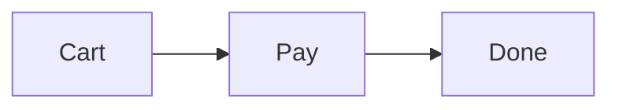
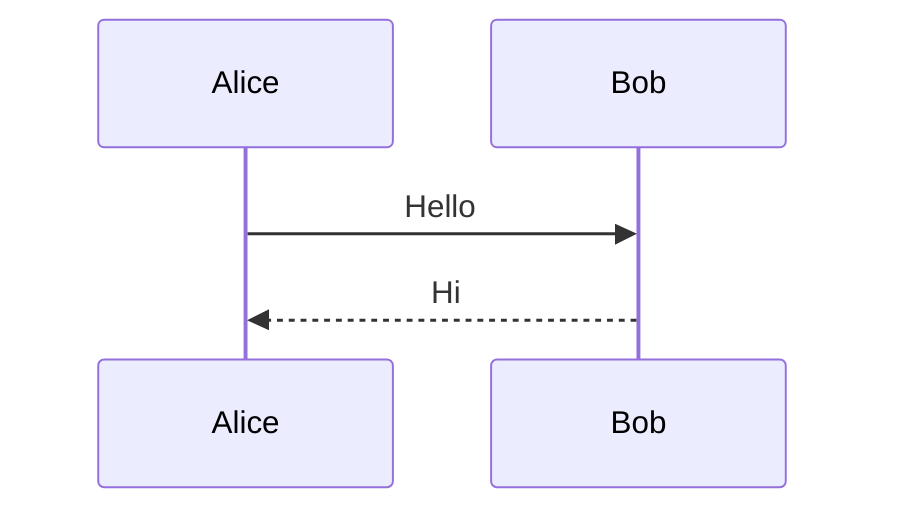
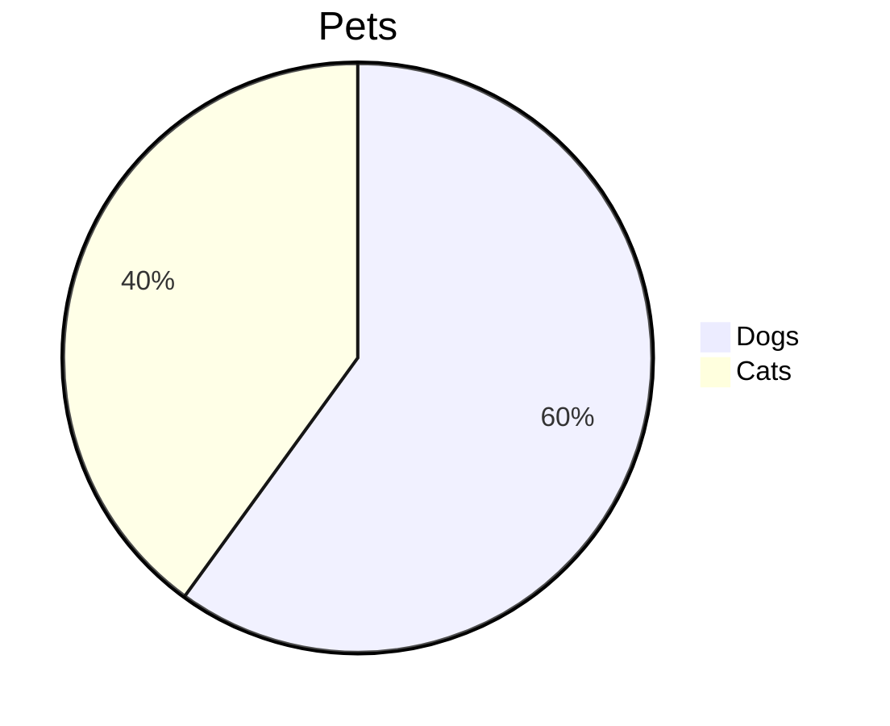
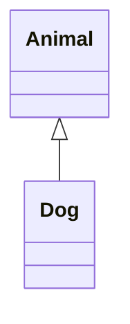
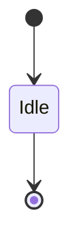

# Diagrams

A flowchart with an accessible title:



A sequence:



A pie chart:



A class diagram:



A state diagram:



One that can't be drawn:

```mermaid
graph TD
  A --> B -->
```

Plain code stays highlighted:

```ts
const answer = 42;
```
