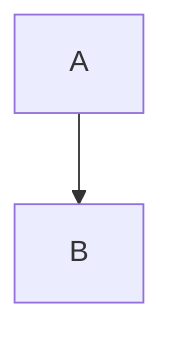
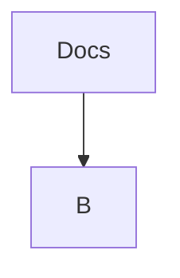
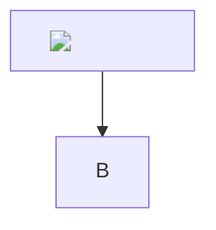
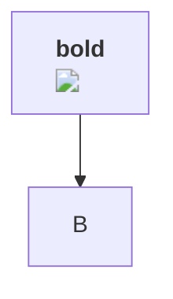
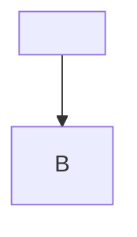
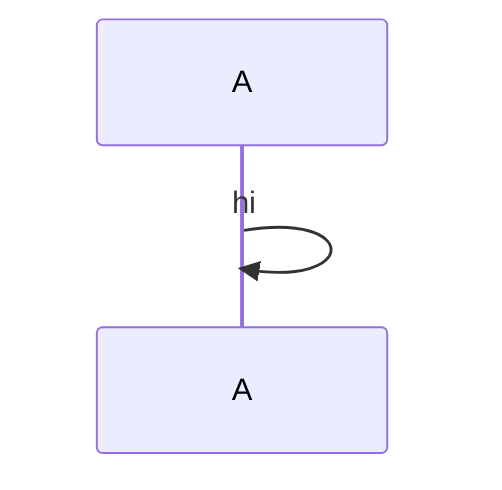

%%%

%%%

%%%

%%%

%%%

%%%

%%%
```mermaid
%%{init: {"theme": "base", "themeVariables": {"primaryColor": "url(pwned.png)", "lineColor": "red url(pwned.png)", "fontFamily": "x url(pwned.png)", "background": "url(pwned.png)", "mainBkg": "url(pwned.png)", "nodeBorder": "url(pwned.png)"}}}%%
graph TD
  A --> B
```
%%%

%%%

