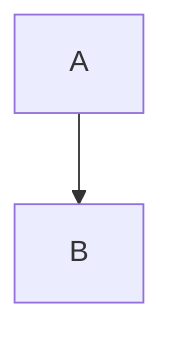
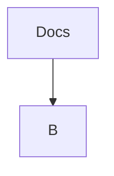
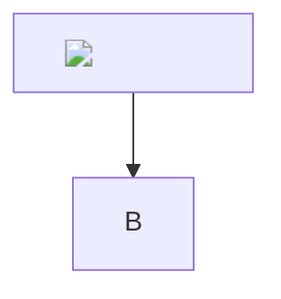
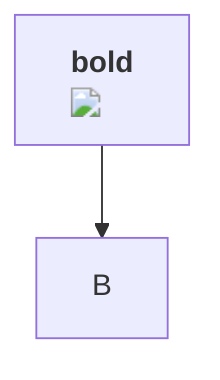
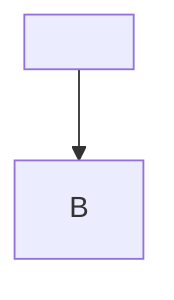
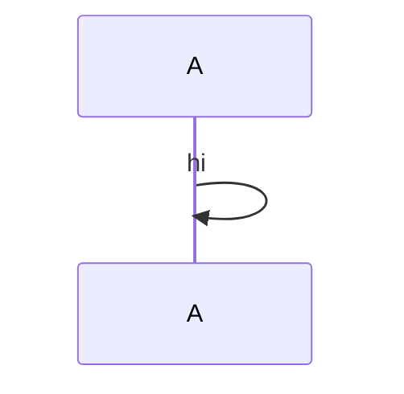

%%%

%%%

%%%

%%%

%%%

%%%

%%%

%%%
```mermaid
graph TD
  E0 --> E1
  E1 --> E2
  E2 --> E3
  E3 --> E4
  E4 --> E5
  E5 --> E6
  E6 --> E7
  E7 --> E8
  E8 --> E9
  E9 --> E10
  E10 --> E11
  E11 --> E12
  E12 --> E13
  E13 --> E14
  E14 --> E15
  E15 --> E16
  E16 --> E17
  E17 --> E18
  E18 --> E19
  E19 --> E20
  E20 --> E21
  E21 --> E22
  E22 --> E23
  E23 --> E24
  E24 --> E25
  E25 --> E26
  E26 --> E27
  E27 --> E28
  E28 --> E29
  E29 --> E30
  E30 --> E31
  E31 --> E32
  E32 --> E33
  E33 --> E34
  E34 --> E35
  E35 --> E36
  E36 --> E37
  E37 --> E38
  E38 --> E39
  E39 --> E40
  E40 --> E41
  E41 --> E42
  E42 --> E43
  E43 --> E44
  E44 --> E45
  E45 --> E46
  E46 --> E47
  E47 --> E48
  E48 --> E49
  E49 --> E50
  E50 --> E51
  E51 --> E52
  E52 --> E53
  E53 --> E54
  E54 --> E55
  E55 --> E56
  E56 --> E57
  E57 --> E58
  E58 --> E59
  E59 --> E60
  E60 --> E61
  E61 --> E62
  E62 --> E63
  E63 --> E64
  E64 --> E65
  E65 --> E66
  E66 --> E67
  E67 --> E68
  E68 --> E69
  E69 --> E70
  E70 --> E71
  E71 --> E72
  E72 --> E73
  E73 --> E74
  E74 --> E75
  E75 --> E76
  E76 --> E77
  E77 --> E78
  E78 --> E79
  E79 --> E80
  E80 --> E81
  E81 --> E82
  E82 --> E83
  E83 --> E84
  E84 --> E85
  E85 --> E86
  E86 --> E87
  E87 --> E88
  E88 --> E89
  E89 --> E90
  E90 --> E91
  E91 --> E92
  E92 --> E93
  E93 --> E94
  E94 --> E95
  E95 --> E96
  E96 --> E97
  E97 --> E98
  E98 --> E99
  E99 --> E100
  E100 --> E101
  E101 --> E102
  E102 --> E103
  E103 --> E104
  E104 --> E105
  E105 --> E106
  E106 --> E107
  E107 --> E108
  E108 --> E109
  E109 --> E110
  E110 --> E111
  E111 --> E112
  E112 --> E113
  E113 --> E114
  E114 --> E115
  E115 --> E116
  E116 --> E117
  E117 --> E118
  E118 --> E119
  E119 --> E120
  E120 --> E121
  E121 --> E122
  E122 --> E123
  E123 --> E124
  E124 --> E125
  E125 --> E126
  E126 --> E127
  E127 --> E128
  E128 --> E129
  E129 --> E130
  E130 --> E131
  E131 --> E132
  E132 --> E133
  E133 --> E134
  E134 --> E135
  E135 --> E136
  E136 --> E137
  E137 --> E138
  E138 --> E139
  E139 --> E140
  E140 --> E141
  E141 --> E142
  E142 --> E143
  E143 --> E144
  E144 --> E145
  E145 --> E146
  E146 --> E147
  E147 --> E148
  E148 --> E149
  E149 --> E150
  E150 --> E151
  E151 --> E152
  E152 --> E153
  E153 --> E154
  E154 --> E155
  E155 --> E156
  E156 --> E157
  E157 --> E158
  E158 --> E159
  E159 --> E160
  E160 --> E161
  E161 --> E162
  E162 --> E163
  E163 --> E164
  E164 --> E165
  E165 --> E166
  E166 --> E167
  E167 --> E168
  E168 --> E169
  E169 --> E170
  E170 --> E171
  E171 --> E172
  E172 --> E173
  E173 --> E174
  E174 --> E175
  E175 --> E176
  E176 --> E177
  E177 --> E178
  E178 --> E179
  E179 --> E180
  E180 --> E181
  E181 --> E182
  E182 --> E183
  E183 --> E184
  E184 --> E185
  E185 --> E186
  E186 --> E187
  E187 --> E188
  E188 --> E189
  E189 --> E190
  E190 --> E191
  E191 --> E192
  E192 --> E193
  E193 --> E194
  E194 --> E195
  E195 --> E196
  E196 --> E197
  E197 --> E198
  E198 --> E199
  E199 --> E200
  E200 --> E201
  E201 --> E202
  E202 --> E203
  E203 --> E204
  E204 --> E205
  E205 --> E206
  E206 --> E207
  E207 --> E208
  E208 --> E209
  E209 --> E210
  E210 --> E211
  E211 --> E212
  E212 --> E213
  E213 --> E214
  E214 --> E215
  E215 --> E216
  E216 --> E217
  E217 --> E218
  E218 --> E219
  E219 --> E220
  E220 --> E221
  E221 --> E222
  E222 --> E223
  E223 --> E224
  E224 --> E225
  E225 --> E226
  E226 --> E227
  E227 --> E228
  E228 --> E229
  E229 --> E230
  E230 --> E231
  E231 --> E232
  E232 --> E233
  E233 --> E234
  E234 --> E235
  E235 --> E236
  E236 --> E237
  E237 --> E238
  E238 --> E239
  E239 --> E240
  E240 --> E241
  E241 --> E242
  E242 --> E243
  E243 --> E244
  E244 --> E245
  E245 --> E246
  E246 --> E247
  E247 --> E248
  E248 --> E249
  E249 --> E250
  E250 --> E251
  E251 --> E252
  E252 --> E253
  E253 --> E254
  E254 --> E255
  E255 --> E256
  E256 --> E257
  E257 --> E258
  E258 --> E259
  E259 --> E260
  E260 --> E261
  E261 --> E262
  E262 --> E263
  E263 --> E264
  E264 --> E265
  E265 --> E266
  E266 --> E267
  E267 --> E268
  E268 --> E269
  E269 --> E270
  E270 --> E271
  E271 --> E272
  E272 --> E273
  E273 --> E274
  E274 --> E275
  E275 --> E276
  E276 --> E277
  E277 --> E278
  E278 --> E279
  E279 --> E280
  E280 --> E281
  E281 --> E282
  E282 --> E283
  E283 --> E284
  E284 --> E285
  E285 --> E286
  E286 --> E287
  E287 --> E288
  E288 --> E289
  E289 --> E290
  E290 --> E291
  E291 --> E292
  E292 --> E293
  E293 --> E294
  E294 --> E295
  E295 --> E296
  E296 --> E297
  E297 --> E298
  E298 --> E299
  E299 --> E300
  E300 --> E301
  E301 --> E302
  E302 --> E303
  E303 --> E304
  E304 --> E305
  E305 --> E306
  E306 --> E307
  E307 --> E308
  E308 --> E309
  E309 --> E310
  E310 --> E311
  E311 --> E312
  E312 --> E313
  E313 --> E314
  E314 --> E315
  E315 --> E316
  E316 --> E317
  E317 --> E318
  E318 --> E319
  E319 --> E320
  E320 --> E321
  E321 --> E322
  E322 --> E323
  E323 --> E324
  E324 --> E325
  E325 --> E326
  E326 --> E327
  E327 --> E328
  E328 --> E329
  E329 --> E330
  E330 --> E331
  E331 --> E332
  E332 --> E333
  E333 --> E334
  E334 --> E335
  E335 --> E336
  E336 --> E337
  E337 --> E338
  E338 --> E339
  E339 --> E340
  E340 --> E341
  E341 --> E342
  E342 --> E343
  E343 --> E344
  E344 --> E345
  E345 --> E346
  E346 --> E347
  E347 --> E348
  E348 --> E349
  E349 --> E350
  E350 --> E351
  E351 --> E352
  E352 --> E353
  E353 --> E354
  E354 --> E355
  E355 --> E356
  E356 --> E357
  E357 --> E358
  E358 --> E359
  E359 --> E360
  E360 --> E361
  E361 --> E362
  E362 --> E363
  E363 --> E364
  E364 --> E365
  E365 --> E366
  E366 --> E367
  E367 --> E368
  E368 --> E369
  E369 --> E370
  E370 --> E371
  E371 --> E372
  E372 --> E373
  E373 --> E374
  E374 --> E375
  E375 --> E376
  E376 --> E377
  E377 --> E378
  E378 --> E379
  E379 --> E380
  E380 --> E381
  E381 --> E382
  E382 --> E383
  E383 --> E384
  E384 --> E385
  E385 --> E386
  E386 --> E387
  E387 --> E388
  E388 --> E389
  E389 --> E390
  E390 --> E391
  E391 --> E392
  E392 --> E393
  E393 --> E394
  E394 --> E395
  E395 --> E396
  E396 --> E397
  E397 --> E398
  E398 --> E399
  E399 --> E400
  E400 --> E401
  E401 --> E402
  E402 --> E403
  E403 --> E404
  E404 --> E405
  E405 --> E406
  E406 --> E407
  E407 --> E408
  E408 --> E409
  E409 --> E410
  E410 --> E411
  E411 --> E412
  E412 --> E413
  E413 --> E414
  E414 --> E415
  E415 --> E416
  E416 --> E417
  E417 --> E418
  E418 --> E419
  E419 --> E420
  E420 --> E421
  E421 --> E422
  E422 --> E423
  E423 --> E424
  E424 --> E425
  E425 --> E426
  E426 --> E427
  E427 --> E428
  E428 --> E429
  E429 --> E430
  E430 --> E431
  E431 --> E432
  E432 --> E433
  E433 --> E434
  E434 --> E435
  E435 --> E436
  E436 --> E437
  E437 --> E438
  E438 --> E439
  E439 --> E440
  E440 --> E441
  E441 --> E442
  E442 --> E443
  E443 --> E444
  E444 --> E445
  E445 --> E446
  E446 --> E447
  E447 --> E448
  E448 --> E449
  E449 --> E450
  E450 --> E451
  E451 --> E452
  E452 --> E453
  E453 --> E454
  E454 --> E455
  E455 --> E456
  E456 --> E457
  E457 --> E458
  E458 --> E459
  E459 --> E460
  E460 --> E461
  E461 --> E462
  E462 --> E463
  E463 --> E464
  E464 --> E465
  E465 --> E466
  E466 --> E467
  E467 --> E468
  E468 --> E469
  E469 --> E470
  E470 --> E471
  E471 --> E472
  E472 --> E473
  E473 --> E474
  E474 --> E475
  E475 --> E476
  E476 --> E477
  E477 --> E478
  E478 --> E479
  E479 --> E480
  E480 --> E481
  E481 --> E482
  E482 --> E483
  E483 --> E484
  E484 --> E485
  E485 --> E486
  E486 --> E487
  E487 --> E488
  E488 --> E489
  E489 --> E490
  E490 --> E491
  E491 --> E492
  E492 --> E493
  E493 --> E494
  E494 --> E495
  E495 --> E496
  E496 --> E497
  E497 --> E498
  E498 --> E499
  E499 --> E500
  E500 --> E501
```
