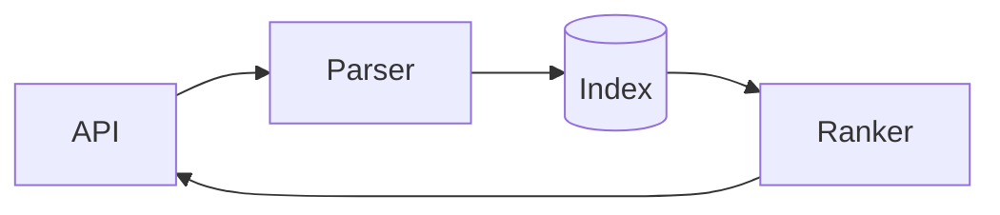

# Search service: execution plan

The service answers queries from the index in under **50 ms** at p95. This plan moves it from the
prototype to production in three checkpoints.

> [!NOTE]
> The p95 target is measured on the staging cluster with production traffic replayed.

## Checkpoints

| Checkpoint | Scope | Status |
| --- | --- | :---: |
| CP1 | Index format and the loader | Done |
| CP2 | Query parser, ranking | In progress |
| CP3 | Load test, rollout | Planned |

- [x] Settle the index layout
- [x] Write the loader and its tests
- [ ] Rank by BM25, then by recency
- [ ] Load test at 2× peak traffic

## Ranking

Each document scores

$$
\text{score}(d, q) = \sum_{t \in q} \operatorname{idf}(t) \cdot \frac{f(t, d)\,(k_1 + 1)}{f(t, d) + k_1 \left(1 - b + b\,\frac{|d|}{\text{avgdl}}\right)}
$$

with $k_1 = 1.2$ and $b = 0.75$.

```ts
export function rank(hits: Hit[], now: number): Hit[] {
  return hits
    .map((hit) => ({ ...hit, score: hit.bm25 + recency(hit, now) }))
    .sort((a, b) => b.score - a.score);
}
```

## Request flow



> The load test runs against a copy of production's index, never the live one.
